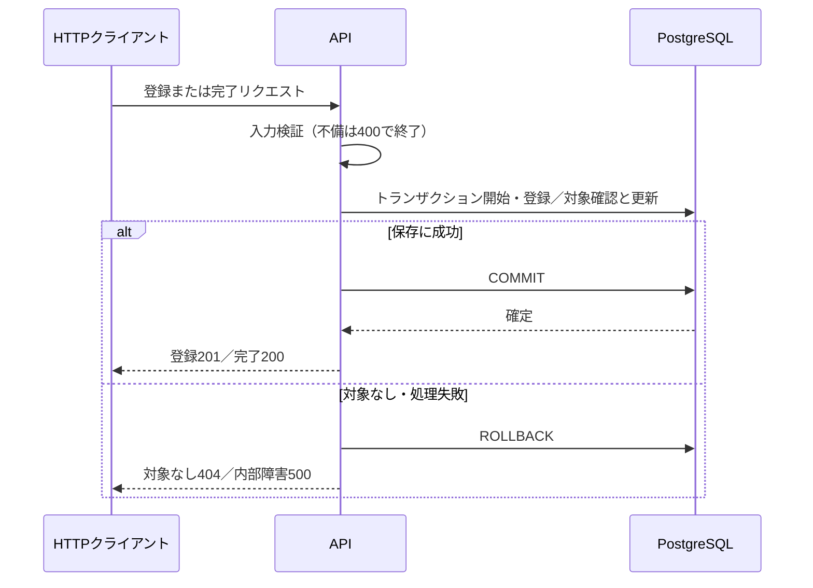
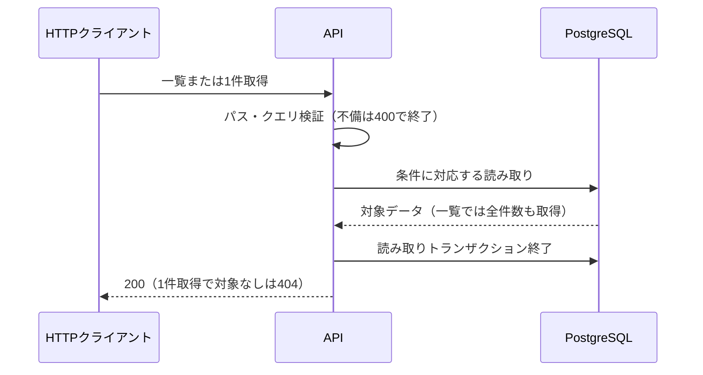
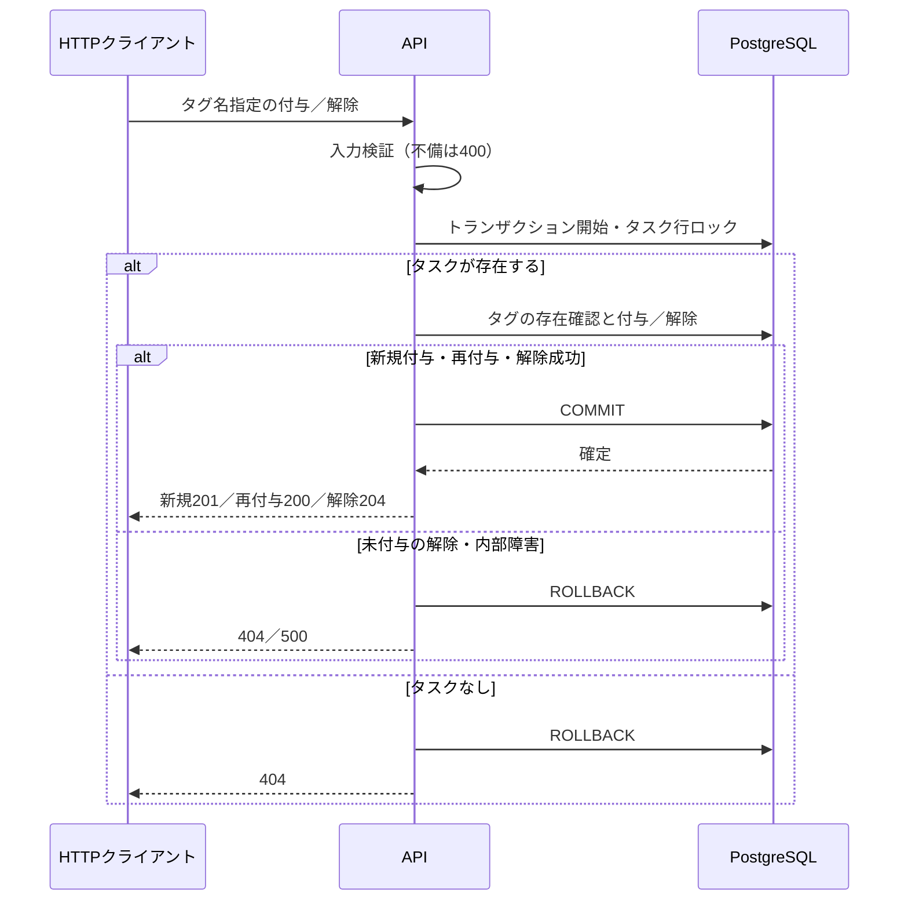

# 方式設計：タスク管理

文書の状態：決定済み

> 2026-11-22：タグ名の直接指定による付与・解除・一覧取得と、その制約・API・データモデルをユーザー承認済み（TASK-Q-004）。

## 1. 対象と方式の概要

[基本設計](../basic-design.md)の既存4機能とタグ追加3機能を、HTTPクライアント→FastAPI→PostgreSQLの同期処理で提供する。配置・依存方向は[共通のDDD4層](../../../steering/api/architecture.md)と[ディレクトリ構成](../../../steering/api/directory-structure.md)に従う。領域は `apps/backend/app/tasks/`、共通処理は `app/shared/`、組み立ては `app/bootstrap/` とする。

## 2. 構成要素と接続

| 構成要素（デプロイ単位） | 役割・接続 |
| --- | --- |
| HTTPクライアント | 利用者の操作をHTTP/JSONでAPIへ送る。専用画面の開発は対象外。 |
| API（Composeのapi） | 入力検証、業務ルール、同期PsycopgによるSQL実行。tasksとsharedは同一プロセス。 |
| PostgreSQL（Composeのdb） | タスクの保存。APIから内部ネットワークで接続する。 |

FlywayはAPI起動前の一時的な実行単位であり、リクエストの処理経路には含めない。

## 3. 処理シーケンス

### 登録・完了

完了済みへの再操作と空オブジェクトは変更なしで成功する。対象がない場合は空オブジェクトでも404。最上位の書き込みユースケースがUnit of Workを所有し、成功応答前に確定する。接続返却時の自動commitに任せない。commit失敗時も成功応答を返さない。

### 一覧・1件取得

読み取りの障害は共通エラー処理で500とし、接続返却前にトランザクションを終了する。

### タグ付与・解除・一覧（追加）

FUNC-005・006に対応する。入力不備はDB操作へ進めず、commit失敗も500とする。FUNC-007のタグ一覧は上記の読み取りシーケンスを使い、同じスナップショットでタスクの存在・タグ件数・ページを取得する。タスクなしは404、タグなしは200の空一覧。新しいデプロイ単位・外部サービス・環境変数は不要。

## 4. 未決定事項・確認事項

[要求仕様](../requirements.md)のTASK-Q-001〜003は2026-11-16にユーザー承認済み。タグ追加部分は[要求仕様](../requirements.md)のTASK-Q-004で承認済み。
