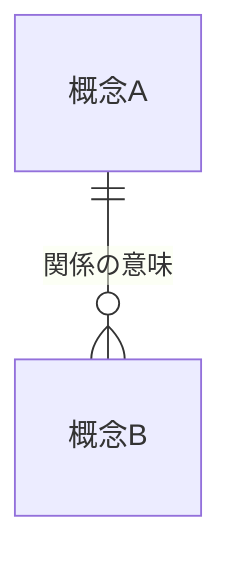

# データモデル設計書：〈サブドメイン名〉

| 項目 | 内容 |
| --- | --- |
| サブドメイン | 〈実装の `app/<subdomain>/` と対応する名前〉 |
| 文書の状態 | 草案 |
| 要求仕様書 | [requirements.md](requirements.md) |
| 基本設計書 | [basic-design.md](basic-design.md) |
| API仕様書 | [openapi.yaml](openapi.yaml) |
| 関連する技術方針 | [データ保存](../../steering/api/data-storage.md) |

> 基本設計の成果物です。`specs/<subdomain>/data-model.md` へコピーし、〈記入欄〉と例のER図を置き換えてください。
> [記載ルール](../README.md#基本設計data-modelmd)と[文書の状態管理](../README.md#文書の状態管理)に従います。
> 今回必要なデータだけを扱い、該当しない項目は理由付きで「対象外」、確認して事項がない場合は「なし」と記載します。未決定の内容は推測せず4節へ記載します。

## 1. 対象・所有するデータ

- 対応する要求・業務ルール：〈REQ・BRのID〉
- 所有するデータと責務：〈この領域が管理する業務データ〉
- 対象外・他領域との境界：〈他領域のデータは所有領域の設計へリンク〉

## 2. 概念データモデル（ER図）

業務上のエンティティ、関係の意味、多重度・任意性をMermaidで示します。カラム・DB型は記載しません。以下は描き方の例であり、仕様ではありません。単一エンティティの場合は関係線を作らず、その名前だけを図へ記載します。

例では、Aに対してBは0件以上、Bに対してAは必ず1件です。`||` は必ず1件、`o|` は0または1件、`o{` は0件以上、`|{` は1件以上を表します。

| エンティティ | 業務上の意味・関係の補足 |
| --- | --- |
| 〈概念名〉 | 〈何を表すか。図だけでは伝わらない関係の条件〉 |

## 3. 論理データモデル（スキーマ定義）

論理エンティティごとに以下を複製します。スキーマは項目・型・制約の定義を指します。DB固有の型・索引・DDLはFlywayのSQLへ記載し、この表には複製しません。

### 〈論理エンティティ名・識別子〉

- 対応する概念：〈2節の概念名。中間エンティティなどを追加する場合は理由〉

| 項目名 | 識別子 | 意味 | 論理型・長さ／精度・値域 | 必須（null不可） | キー・参照先 | 初期値・設定主体 |
| --- | --- | --- | --- | --- | --- | --- |
| 〈項目名〉 | 〈項目の識別子〉 | 〈業務上の意味〉 | 〈文字列・整数・日時などと必要な制約〉 | 〈はい／いいえ〉 | 〈主キー／一意／参照先の項目／なし〉 | 〈利用者入力／アプリ生成／DB既定値など。なければ「なし」〉 |

- 整合性の条件：〈複合キー・複合一意制約、項目間制約、関連先の削除・更新時の扱いなど、該当するものだけ記載〉
- 関連する仕様：〈業務ルールのID、基本設計の状態遷移、code-values.mdなど。本文を複製しない〉
- APIとの対応：〈OpenAPIの対象スキーマ。項目名・型・必須性が異なる場合は変換・生成・省略の意味を補足〉
- 実装との対応：〈実装後にマイグレーション・Repositoryなどへリンク。未実装ならその旨を記載し、存在しないリンクを作らない〉

## 4. 未決定事項・確認事項

解決した内容は該当箇所へ反映します。新しい業務判断が必要なら要求仕様の確認事項とも対応付けます。

| 確認ID | 未決定・未確認の内容 | 影響する要求・データ | 判断に必要な情報・確認先 | 状態・確認結果 |
| --- | --- | --- | --- | --- |
| 〈領域略称〉-DM-Q-001 | 〈確認が必要な内容〉 | 〈要求ID・項目・関係〉 | 〈情報・確認先〉 | 〈未確認／解決済みとその結果〉 |
