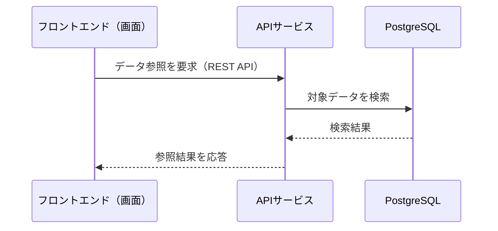

# 方式設計：〈サブドメイン名〉

| 項目 | 内容 |
| --- | --- |
| サブドメイン | 〈対象領域〉 |
| 文書の状態 | 草案 |
| 基本設計書 | [basic-design.md](../basic-design.md) |
| API仕様書 | [openapi.yaml](../openapi.yaml) |
| 共通の技術方針 | [アーキテクチャ](../../../steering/api/architecture.md)・[Docker Compose](../../../steering/api/docker-compose.md) |

> このファイルを `specs/<subdomain>/detailed-design/architecture.md` へコピーし、〈記入欄〉を置き換えてください。
> このサブドメインの機能を実現する方式を、説明文とデプロイ単位のシーケンス図で示します。図の例は実際の機能に合わせて変更してください。

> 状態の切り替えは[文書の状態管理](../../README.md#文書の状態管理)に従います。「決定済み」は記載した範囲への合意を示し、実装・テストの完了を意味しません。

## 1. 対象と方式の概要

- 対象とする機能・要求：〈基本設計の機能ID、要求ID〉
- 採用する方式：〈どのシステムが、どの通信・処理・保存を担当するか〉
- この方式を採用する理由：〈基本設計の動作や整合性、非機能要求を満たす理由〉
- 前提・制約：〈適用するsteeringと、この領域固有の条件〉

共通方針では、REST APIを同期処理で提供し、PostgreSQLへ保存します。この領域の具体的な処理がその構成の中でどう動くかを記載します。

## 2. 構成要素と接続

登場人物はフロントエンド、APIサービス、DB、外部サービスなどのデプロイ単位とします。ルーター・ユースケース・RepositoryなどのクラスやDDDの各層は、独立した登場人物にしません。
複数サブドメインが同じAPIサービス内で動く場合は、同じ登場人物として扱います。処理の担当領域は説明文や図の注記で補足します。

| 構成要素 | デプロイ単位・実行場所 | この領域での役割 | 接続先・通信方式 |
| --- | --- | --- | --- |
| 〈名称〉 | 〈APIコンテナ、DBコンテナ、外部のクライアントなど〉 | 〈担当する処理〉 | 〈接続相手とプロトコルなど〉 |

画面が登場する場合は、フロントエンド／クライアントの操作として表します。画面を登場させること自体は、本リポジトリへのフロントエンド実装の追加を意味しません。

## 3. 処理シーケンス

機能または代表的な処理パターンごとに以下を複製します。同じ方式を使う機能をまとめる場合は、対象の機能IDと違いを明記します。

### 〈機能ID・処理名〉

- 対応するAPI：〈OpenAPIのoperationIdなど〉
- 開始条件：〈誰が、どの状態で操作するか〉
- 処理の説明：〈要求受付から応答までの流れ、保存・外部連携のタイミング〉

次は参照処理の例です。実際の機能に合わせて、登場人物・メッセージ・失敗時の分岐を具体化します。

図と説明で、データの向き、処理順序、応答を待つ箇所を明確にします。書き込みでは、DBの更新範囲と確定・取り消しのタイミングも示します。SQL本文やメソッド単位の呼び出しはこの図に展開しません。

| 分岐・失敗条件 | 処理・データへの影響 | 呼び出し元への結果 | 関連する仕様 |
| --- | --- | --- | --- |
| 〈条件〉 | 〈処理中断、変更の取り消しなど〉 | 〈応答・通知〉 | 〈基本設計やOpenAPIへの参照〉 |

必要に応じて図の `alt` などで分岐を表します。入出力の項目・型・ステータスの正確な定義はOpenAPIを参照します。

## 4. 未決定事項・確認事項

| 確認事項 | 影響する機能・構成要素 | 判断に必要な情報 | 状態・確認結果 |
| --- | --- | --- | --- |
| 〈未確認の内容。確認済みで事項がなければ「なし」〉 | 〈対象〉 | 〈確認先・前提〉 | 〈未確認／解決済みとその結果〉 |
