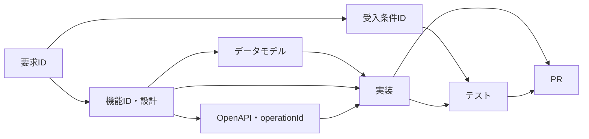

# 成果物のつながりと変更影響

状態：決定済み（2026-11-17更新：振り返りから次回の改善への参照を追加）

このキットでのグラフエンジニアリングは、要求・設計・実装・テスト・PRの関係をたどり、変更の影響と不足を確認することです。[各工程のループ](README.md)で修正すべき範囲を、このつながりから判断します。

## つなぐ成果物

矢印は成果物間の対応を表し、工程の実行順序やコードのimport方向ではありません。業務ルール・非機能要求も、既存のIDで機能・受入条件と対応付けます。

| 関係 | 既存の記録先・表し方 |
| --- | --- |
| 要求・業務ルール・非機能要求→受入条件 | `requirements.md` のREQ・BR・NFR・ACのID |
| 要求・受入条件→設計 | `basic-design.md` の機能IDと要求・受入条件への参照 |
| 設計→API契約・詳細設計 | operationId、機能ID、対象文書の該当箇所への参照 |
| 要求・設計→データモデル→保存処理 | `data-model.md` の要求ID、概念と論理エンティティの対応、実装後のマイグレーション・Repositoryへの参照 |
| 設計→実装 | 実装のサブドメイン・層・機能を表す名前。対応が分かりにくい場合だけファイル参照を補足 |
| 受入条件・実装→テスト | `testing.md` の対応付け、既存のテスト配置・名前。必要な場合だけテストファイルなどへの参照を補足 |
| 変更・検証結果→PR | 対象の要求ID・設計書、変更の目的、実行したTaskと結果 |
| 作業結果→振り返り→次回の改善案 | 完了報告の3項目。根拠となる設計・検証結果・PRや、改善の反映先を必要に応じて参照 |

IDの付け方と文書の項目は [specs](../../specs/README.md)、実装・テストの配置は [ディレクトリ構成](../api/directory-structure.md) に従います。全関数へのID付与や、別の巨大な対応表・グラフDB・自動実行基盤は導入しません。関係が複雑な場合だけ図を追加します。
まだ実装していない段階では、実装・テスト・PRへの参照を作りません。要求・設計モードは要求から設計・検証観点まで、自律実装モードは実装・テスト・PRまでを確認します。

## 作業中の使い方

| タイミング | 確認すること |
| --- | --- |
| 着手時 | 対象の要求と受入条件から、関連する設計・API・実装・テストをたどる |
| 変更時 | 変更箇所から利用側・依存先・関連テストへの影響を調べ、必要な成果物を更新する |
| 完了時 | 要求の実装漏れ、受入条件の検証漏れ、要求にない追加実装、古くなった参照がないか確認する |

これらの確認を終え、対象モードの作業を終了した後に[振り返り](README.md#工程の最後の振り返り)を行います。改善案と反映済みの変更を区別し、次回への提案を理由に今回の作業を自動的に再開しません。

参照だけでは分からないコードの依存関係は、実際の呼び出し元・利用箇所を調べて確認します。同じサブドメイン内に限定せず、`shared`・組み立て処理・他領域との公開契約への影響も確認します。
サブドメイン横断の変更は責任を持つ領域を明記し、関係先を参照します。同じ仕様や履歴を複数領域へ複製しません。

## 設計・実装・検証の整合

データの変更では `data-model.md` の概念ER図・論理スキーマから、OpenAPI・マイグレーション・Repository・関連テストへの影響を確認します。API入力と保存項目の必須性の違いなどは、生成や省略時の扱いを含めて設計と照合します。

手書きのOpenAPIをAPI契約の正とし、生成結果は照合に使います。生成結果で仕様を上書きして差分を消しません。比較対象・表記差の扱い・出力Taskとテストの役割は [OpenAPIの整合方針](../../specs/README.md#fastapiが生成するopenapiとの整合方法) を参照します。
必要な検証の範囲は `testing.md`、Taskの実行方法は `operations.md` で確認し、結果はPRに要約します。要求・設計から期待結果を確認し、現在のコードの動作だけを根拠にテストを作りません。
重要な仕様・設計の変更は、決定後に設計書と `history/` を同じ変更で更新します。初期設計や誤字修正の扱い、Gitによる版管理は [specsの履歴管理方針](../../specs/README.md) に従います。

実装やテストが未完了なら、その関係も未確認として扱います。存在しない参照や、実施していない検証結果を補いません。共通の技術方針を複製する代わりに、適用する [steering/api](../api/README.md) と各領域の文書を参照します。
